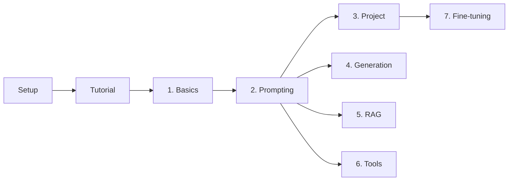

# Course documentation

Follow this order:

1. [Setup](setup.md): install the course and download the model.
2. [Tutorial](tutorial.md): build a working customer-message classifier in about 20 minutes.
3. The [lessons](#lessons), 1 to 7, in order.

Use the [how-to guides](#how-to-guides) and [reference pages](#reference) when you need them.

## Lessons

Each page explains the ideas behind a lesson, walks through the code, lists common mistakes, gives
an exercise with an answer, and links to further reading. Every lesson script also opens with a
docstring: the goal, the idea, the command to run, and what you should see.

| Lesson | Why it matters | Covers |
|--------|----------------|--------|
| [1. Basics](lessons/01-basics.md) | Every later lesson loads a model and chats with it. This lesson shows what happens underneath, so later errors and odd answers make sense. | GGUF files, completion vs chat, system prompts, the chat template |
| [2. Prompting](lessons/02-prompting.md) | A model's raw answer is prose, but a program needs a fixed format. This is how you get answers your code can use. | Prompt formats, few-shot, JSON mode, JSON Schema, conversation memory |
| [3. Project](lessons/03-project.md) | A demo that works once proves little. A score on messages the model has never seen tells you whether to trust it, especially on the tricky cases. | The message classifier, scoring on unseen messages, what examples cost |
| [4. Generation](lessons/04-generation.md) | The same prompt can give different answers, and a long chat eventually stops fitting. This lesson gives you control over both. | Temperature and seed, streaming, tokens and the context window |
| [5. RAG](lessons/05-rag.md) | The model knows nothing about your shop. Without this it guesses; with it, every answer comes from your documents, with a source you can check. | Embeddings, cosine search, citations, refusing, prompt injection |
| [6. Tools](lessons/06-tools.md) | Models guess at facts and arithmetic. Here the model calls your code for exact answers, and your code checks every call first. | Tool calling, Pydantic validation, retries |
| [7. Fine-tuning](lessons/07-finetuning.md) | When a prompt gets long, slow or fragile, you can teach the task by example instead. This lesson shows how, and how to check that it paid off. | LoRA, train/validation/test data, accuracy, ROUGE (Apple Silicon only) |

Lessons 1 and 2 are the base for everything else. Lessons 4, 5 and 6 can be done in any order.
Lesson 7 compares against the score from lesson 3, so do 3 first.

## How-to guides

| Guide | Use it to |
|-------|-----------|
| [Change models](howto/switch-models.md) | Download and switch between 3B, 8B and 70B models |
| [Add a model profile](howto/add-a-model-profile.md) | Make a new model selectable by name |
| [Run the tests](howto/run-the-tests.md) | Check your setup, with or without a model |
| [Change generation settings](howto/change-generation-settings.md) | Control randomness, answer length and context size |
| [Add your own messages](howto/add-your-own-messages.md) | Score the classifier on your own data |

## Reference

| Page | Read it when |
|------|--------------|
| [Setup](setup.md) | You need the requirements, extra downloads or install fixes |
| [Models and benchmarks](models.md) | You want to know what your machine can run, and how fast |
| [References](references.md) | You want to read more, grouped by topic |
| [Datasets](../data/README.md) | You want to know what the data contains |

## What is where

| Folder | Contents |
|--------|----------|
| `lessons/` | The course scripts, numbered in the order to do them |
| `src/llama_course/` | Code the lessons share (see the code map below) |
| `configs/models.yaml` | Model profiles |
| `data/` | Datasets, all synthetic. See [data/README.md](../data/README.md) |
| `scripts/` | Model download, benchmark, data split, link check |
| `tests/` | Tests. Most use a fake model, so they run anywhere |
| `docs/` | This documentation |

## Code map

The lessons import their helpers from `src/llama_course/`:

| Module | What it does |
|--------|--------------|
| `llm.py` | `get_llm()`: loads the model chosen by the profile, once |
| `conversation.py`, `prompts.py` | Multi-turn chat and prompt builders |
| `structured.py` | JSON output, with optional Pydantic validation |
| `generation.py`, `context.py` | Streaming, token counting, trimming a long chat |
| `classify.py`, `data.py` | The message classifier and the datasets |
| `rag.py` | Chunking, search, cited answers |
| `tools.py`, `shop_tools.py` | Tool calling and the example tools |
| `finetune.py`, `rouge.py` | Training data and scoring |
| `benchmark.py` | Speed measurement |
