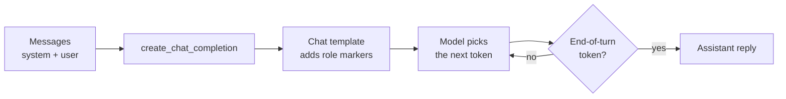

# Lesson 1: Basics

You load a Llama model, ask it a question, and learn the difference between plain text
completion and a chat.

**Why it matters:** Every later lesson loads a model and chats with it. This lesson shows what happens underneath, so later errors and odd answers make sense.

Before you start: finish the [setup](../setup.md). You need basic Python (functions, lists,
dictionaries). You do not need to know anything about AI yet.

## New words

| Word | Meaning |
|------|---------|
| Language model | A program that has learned, from a lot of text, to guess what text comes next |
| Token | A small piece of text the model works with: a short word, part of a longer word, or a symbol |
| Weights | The numbers the model learned during training. A "3B" model has about 3 billion of them |
| Prompt | The text you send to the model |
| Completion | The text the model writes back, continuing your prompt |

All course terms are in the [glossary](../glossary.md).

## Run it

```bash
python lessons/01_basics/01_chat.py
python lessons/01_basics/02_conversation.py
python lessons/01_basics/03_system_prompt.py
python lessons/01_basics/04_chat_template.py
```

## The ideas

A language model writes one token at a time. At each step it looks at all the text so far and
picks a likely next token. It repeats this until it reaches a stop signal or a length limit.

Here is what happens when you send a chat:



### A model file

The model is a single file in GGUF format. GGUF is the file format that `llama.cpp`, the engine
running the model, reads. The file holds the weights and the model's settings.

The file name tells you what is inside. `Llama-3.2-3B-Instruct-Q4_K_M.gguf` means:

- `Llama-3.2`: the model family and version.
- `3B`: about 3 billion weights.
- `Instruct`: trained to follow instructions and hold a conversation.
- `Q4_K_M`: each weight is stored in about 4.5 bits instead of 16.

Storing weights in fewer bits is called quantization. It makes the file small enough for a laptop,
at a small cost in answer quality.

### Completion

Plain completion means the model continues your text. When you send
`llm("Why do bicycle tires lose air?")`, the model does not know you asked a question. It writes
whatever is likely to come next. That might be an answer. It might also be more questions, or a
rambling essay. Lesson 1.1 shows this.

### Chat

A chat is a list of messages. Each message has a `role` (who is speaking) and `content` (what
they say):

| Role | Who speaks |
|------|-----------|
| `system` | You, setting the rules before the conversation starts |
| `user` | The person asking |
| `assistant` | The model, in its earlier replies |

`create_chat_completion(messages=...)` sends the list and returns the model's next message.
Lesson 1.3 uses a system message to turn the model into a bike shop's help desk that refuses
anything else.

### The chat template

The model only reads text, so the roles must be written into the text somehow. Llama 3 uses
special tokens for this, such as `<|start_header_id|>user<|end_header_id|>`. The set of rules
for where these tokens go is called the chat template.

`create_chat_completion` adds the special tokens for you. Lesson 1.4 writes them by hand with
`llama3_chat_prompt`, so you can see the text the model actually receives. It also shows the stop
signal: `<|eot_id|>`, short for "end of turn". Without it, the model keeps writing.

## Code map

| File | What it shows |
|------|---------------|
| `src/llama_course/llm.py` | `get_llm()` loads the model chosen by the profile, once per run |
| `src/llama_course/prompts.py` | `llama3_chat_prompt` builds the raw template |
| `src/llama_course/conversation.py` | `message_text` pulls the reply out of a result |

## Common mistakes

- Using plain completion for a question: if the reply rambles, switch to `create_chat_completion`.
- Forgetting `max_tokens`: this sets the longest reply, in tokens. Without it, the reply may stop
  mid-sentence or run longer than you want.
- Putting `<|begin_of_text|>` in a hand-written prompt: llama.cpp adds this token itself, so you
  get a warning about a duplicate. `llama3_chat_prompt` leaves it out for this reason.
- Expecting the same answer every run: the default `temperature` setting adds randomness. Lesson 4
  covers it.

## Exercise

1. Add `temperature=0.0` to the call in `01_chat.py` and run it twice. What changes?
2. How many tokens does the prompt in lesson 1.4 use?

<details>
<summary>Answer</summary>

1. Nothing: the two outputs are identical. Temperature 0 always picks the most likely next token,
   so there is no randomness. (Checked on the 3B model with a 30-token limit.)
2. Add this line after `prompt` is built:

   ```python
   print(len(llm.tokenize(prompt.encode(), add_bos=False)))
   ```

   It prints 75 for the 246-character prompt. Tokens are pieces of words, so the count matches
   neither the number of words nor the number of characters.
</details>

## Go deeper

- [llama.cpp](https://github.com/ggml-org/llama.cpp): the engine that runs the model.
- [llama-cpp-python documentation](https://llama-cpp-python.readthedocs.io/en/latest/): the Python
  API used in every lesson.
- [The GGUF file format](https://github.com/ggml-org/ggml/blob/master/docs/gguf.md): what is inside
  a model file.
- [Llama 3 prompt format](https://www.llama.com/docs/model-cards-and-prompt-formats/meta-llama-3/):
  the special tokens and where each goes.
- [Chat templates in Hugging Face Transformers](https://huggingface.co/docs/transformers/chat_templating):
  why every model family has its own template.
