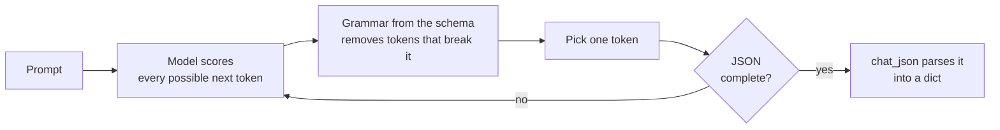

# Lesson 2: Prompting

You shape what the model gives back: its layout, its examples, and a JSON format your program can
read.

**Why it matters:** A model's raw answer is prose, but a program needs a fixed format. This is how you get answers your code can use.

Before you start: do [lesson 1](01-basics.md). You should know what a prompt, a token and a chat
message are.

## New words

| Word | Meaning |
|------|---------|
| Few-shot prompting | Showing the model a few solved examples in the prompt so it copies the pattern |
| Zero-shot | Asking without any examples |
| JSON | A text format for data, made of keys and values, that Python reads with `json.loads` |
| JSON Schema | A description of the JSON you expect: which keys, and what type each value has |
| Grammar | A set of rules that limits which tokens the model may pick next |

All course terms are in the [glossary](../glossary.md).

## Run it

```bash
python lessons/02_prompting/01_prompt_formatting.py
python lessons/02_prompting/02_few_shot.py
python lessons/02_prompting/03_json_inventory.py
python lessons/02_prompting/04_json_schema.py
python lessons/02_prompting/05_conversation_class.py
```

## The ideas

### Format the prompt so the answer comes next

With plain completion, the model continues your text. So write the text so that the answer is the
natural next thing. Lesson 2.1 writes `Instruction:`, `Question:` and then `Answer:`. After
`Answer:`, the likeliest continuation is an answer.

A stop string ends the reply early. With `stop=["Question:"]`, the model stops before it starts
inventing a next question.

### Few-shot prompting

Show a few inputs with their labels, then add a new input with the label left blank. The model
copies the pattern and fills in the blank. `few_shot_prompt` builds this text for you.

Lesson 2.2 rates cycling routes as Easy, Moderate or Hard, with one example of each. The new
route is harder than every example. With the examples alone, the 3B model answers `Very Hard`, a
label that does not exist. Examples show the model the format of the answer. They do not tell it
which answers are allowed. Adding one line that names the three labels fixes it. Lesson 3 shows
that examples can also help on some inputs and hurt on others.

### JSON mode

Code can't read a sentence like "about two dozen tubes". It needs data. Passing
`response_format={"type": "json_object"}` makes the model reply in valid JSON. Lesson 2.3 turns a
supplier's delivery note into a dictionary of parts and quantities.

This works because of a grammar. At every step, llama.cpp removes the tokens that would break the
JSON, and the model can only pick from what is left:



JSON mode makes sure the reply is valid JSON, but not which keys it has. A JSON Schema fixes those
too. Lesson 2.4 asks for a `name` string, a `price_usd` number and a `weight_kg` number, and
gets exactly those keys. `chat_json` sends the request and turns the reply into a Python
dictionary.

### Memory is your job

The model remembers nothing between calls. Each call starts from zero. To hold a conversation, you
send the whole history every time.

`Conversation` does this. It keeps the list of messages and sends all of it on each turn. That is
why the follow-up in lesson 2.5, "something I can fold and take on the train for the same ride",
gets a sensible answer: the model can still see the first request. The list grows with every turn.
Lesson 4 covers what happens when it gets too long.

## Code map

| File | What it shows |
|------|---------------|
| `src/llama_course/prompts.py` | `qa_prompt`, `few_shot_prompt` |
| `src/llama_course/structured.py` | `chat_json`, and `InvalidJSONReply` for a reply that is not JSON |
| `src/llama_course/conversation.py` | `Conversation`: history, one method per turn |

## Common mistakes

- A reply cut off mid-JSON: if `max_tokens` is too small, the JSON stops in the middle and
  parsing fails with `InvalidJSONReply`. Leave room for the whole object.
- Valid JSON, wrong content: JSON mode checks the format, not the facts. The model can still
  miscount. Check the values you care about.
- Sharing a mutable default: an earlier version of `Conversation` used `history=[]` as a default
  argument. Python creates that list once, so every chatbot shared it. The fix is `history=None`.
  A test covers it.
- Too many examples: the model copies whatever is in the examples. Pick examples that cover the
  cases you care about, and test with and without them.

## Exercise

In lesson 2.4, add a `frame_material` string field to `SCHEMA` and to `required`. The description
never says what the frame is made of. What does the model return? How do you let it say "unknown"?

<details>
<summary>Answer</summary>

It returns `'frame_material': 'hardtail'`. The schema demands a string, so the model has to write
something. It takes the nearest word in the text, which describes the frame's shape, not its
material. A required field forces an answer even when the text has none.

To allow "unknown", use `"frame_material": {"type": ["string", "null"]}` and add to the system
prompt: "Use null for anything the description does not state." Then the 3B model returns
`'frame_material': None`. (Both runs at temperature 0.)
</details>

## Go deeper

- [Language Models are Few-Shot Learners](https://arxiv.org/abs/2005.14165): the paper that
  showed models learn tasks from examples in the prompt.
- [Prompt Engineering Guide](https://www.promptingguide.ai/): a catalogue of prompting techniques.
- [Claude prompt engineering overview](https://docs.anthropic.com/en/docs/build-with-claude/prompt-engineering/overview):
  practical advice that applies to most chat models.
- [Understanding JSON Schema](https://json-schema.org/understanding-json-schema/): the language
  lesson 2.4 uses to fix keys and types.
- [llama.cpp grammars](https://github.com/ggml-org/llama.cpp/blob/master/grammars/README.md): how
  output is restricted to a format.
