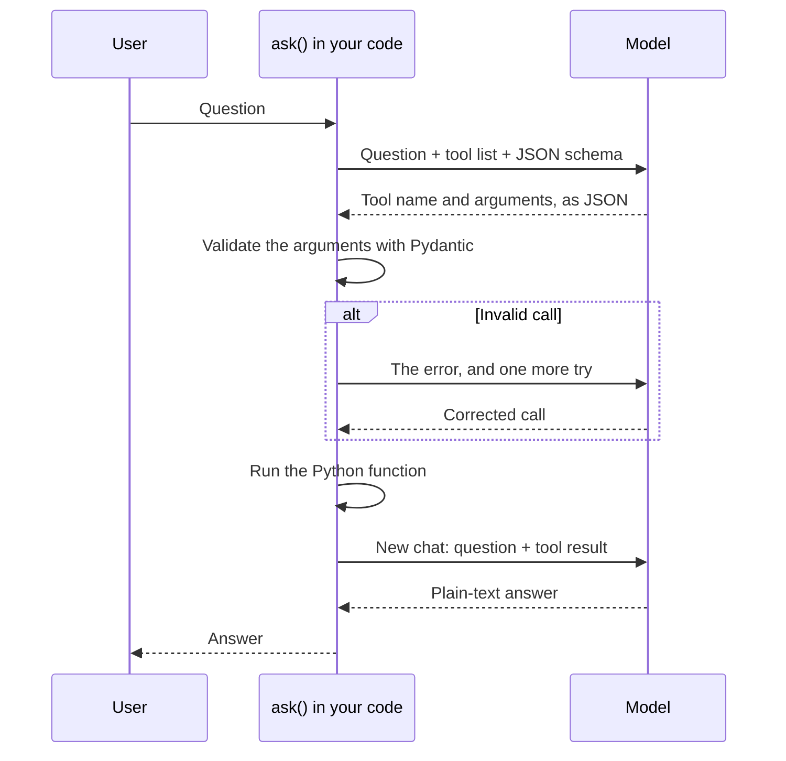

# Lesson 6: Tools and validated output

You let the model call Python functions, and you turn its JSON into typed objects that are checked
before use.

**Why it matters:** Models guess at facts and arithmetic. Here the model calls your code for exact answers, and your code checks every call first.

Before you start: do [lesson 2](02-prompting.md). You should know what JSON and a JSON Schema are.

## New words

| Word | Meaning |
|------|---------|
| Tool | A Python function the model is allowed to ask for, such as a stock lookup |
| Tool call | The model's request to run a tool, written as JSON: the tool's name and its arguments |
| Pydantic | A Python library that checks data against a class you define: types, ranges and required fields |
| Validation | Checking data before you use it, and rejecting it if it is wrong |

All course terms are in the [glossary](../glossary.md).

## Run it

```bash
python lessons/06_tools/01_tool_calling.py
python lessons/06_tools/02_validated_output.py
```

## The ideas

A language model writes likely text. It cannot look up how many helmets are in stock, and it is
not reliable at arithmetic. Tool calling splits the job:

1. The model picks a function and its arguments, written as JSON, for example
   `{"tool": "get_stock", "arguments": {"item": "helmets"}}`.
2. Your code checks the call and runs the function.
3. The model writes the answer from the function's result.



### The model never runs code

The model only writes JSON. Your code decides what runs. Only functions you registered in a
`ToolBox` can run, and the example tools are pure: they read no files, use no network and run no
shell commands.

### The schema forces a valid call

`ToolBox.schema()` builds a JSON Schema from your tools. It has one option per tool, with the
tool's name and argument types, plus a `no_tool` option for questions that need no tool. The model
cannot name a tool that does not exist.

### Pydantic validates the arguments

Each tool describes its arguments as a Pydantic class. For example, `order_total: float =
Field(ge=0)` means "a number, 0 or more". A negative total is rejected before the function runs.
The schema only guides what the model writes; Pydantic does the real check.

### Errors go back to the model

If the model names an unknown tool, sends bad arguments or writes broken JSON, the error is sent
back with an explanation. The model gets one more try. If that fails too, `ask` raises
`ToolCallFailed`. A tool can also raise `ToolError` itself, for example for an unknown item. That
message becomes the result, and the model explains it to the user.

### Why a fresh chat for the answer

The tool-call chat tells the model to reply with JSON only. When that chat was reused for the final
answer, the answer also came back as JSON. So the answer step starts a new chat.

### Native tool calling

llama-cpp-python can pass a `tools=` argument to the model's chat template, but it has no code to
read Llama 3's tool calls back. This course builds the whole loop itself instead.

### Validated output without tools

Lesson 6.2 applies the same checks to plain data. `chat_model` asks for JSON that matches a
Pydantic class, validates it, and retries once with the error shown to the model. On the 32
supplier delivery notes, the quantities matched on 30, and no reply was invalid. Validation catches
a wrong type or a negative count. It cannot catch a wrong number; that needs a check against known
answers.

## Code map

| File | What it shows |
|------|---------------|
| `src/llama_course/tools.py` | `Tool`, `ToolBox`, `ask`, `ToolError`, `ToolCallFailed` |
| `src/llama_course/shop_tools.py` | Three safe example tools |
| `src/llama_course/structured.py` | `chat_model`, `describe_errors`, `InvalidModelReply` |

## Common mistakes

- Assuming the model will use the tool: it decides from the tool's description. Vague
  descriptions get ignored.
- Nested argument models: the example tools use flat arguments only. Nested Pydantic models add
  `$ref` entries to the schema, which this course did not test. Keep arguments flat.
- Tools with side effects: do not let a call the model chose delete, send or pay without your own
  checks. For anything that can't be undone, ask a person first.
- Trusting a 3B model's choices: it sometimes picks the wrong tool. Show the call, as the lesson
  does, and test what happens when it fails.

## Exercise

Add an `opening_hours` tool that takes a `day` and returns the store hours, then ask "Is the store
open on Sunday?" Compare a short and a long tool description.

<details>
<summary>Answer</summary>

```python
from pydantic import BaseModel, Field
from llama_course.llm import get_llm
from llama_course.shop_tools import SHOP_TOOLS
from llama_course.tools import Tool, ToolBox, ask

class HoursArgs(BaseModel):
    day: str = Field(description="Weekday name, for example 'sunday'")

HOURS = {"monday": "10 AM to 7 PM", "saturday": "9 AM to 6 PM", "sunday": "closed"}
hours = lambda a: HOURS.get(a.day.lower(), "unknown day")

description = ("Look up the opening hours of our Portland store for a weekday. "
               "Use it for any question about when the store is open or closed.")
box = ToolBox([*SHOP_TOOLS.tools.values(), Tool("opening_hours", description, HoursArgs, hours)])
print(ask(get_llm(), box, "Is the store open on Sunday?", temperature=0.0))
```

With the short description "Opening hours of the Portland store on a given weekday." the 3B model
chose no tool for both "Is the store open on Sunday?" and "What are the store hours on Saturday?",
and guessed. With the long description it called `opening_hours` for the Sunday question and
answered "closed", but it still skipped the tool for the Saturday question. The description decides
whether a tool gets used, and a small model is not reliable at it.
</details>

## Go deeper

- [Pydantic documentation](https://docs.pydantic.dev/latest/): validation, constraints and JSON
  Schema export.
- [Tool use in chat templates](https://huggingface.co/docs/transformers/chat_extras): how models
  are given tool descriptions.
- [Toolformer](https://arxiv.org/abs/2302.04761): models that learn when to call tools.
- [ReAct](https://arxiv.org/abs/2210.03629): interleaving reasoning with tool calls, the idea behind
  most agents.
- [Understanding JSON Schema](https://json-schema.org/understanding-json-schema/): the format that
  constrains the tool call.
