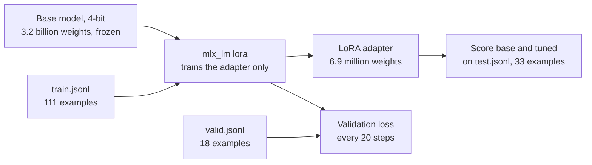

# Lesson 7: Fine-tuning

You train a small add-on for the model on your own examples, then check whether it helped. You also
learn how to score generated text.

**Why it matters:** When a prompt gets long, slow or fragile, you can teach the task by example instead. This lesson shows how, and how to check that it paid off.

```bash
pip install -e ".[finetune]"     # Apple Silicon only
python lessons/07_finetuning/01_prepare_data.py
python lessons/07_finetuning/02_train_lora.py
python lessons/07_finetuning/03_evaluate_tuned_model.py
python lessons/07_finetuning/04_rouge_summaries.py
```

## The ideas

### Fine-tuning teaches by example

Instead of describing the task in the prompt, you show the model
many pairs: a customer message, and the right label. The prompt can then be short.

### LoRA trains a small add-on

Changing every weight of a 3B model needs far more memory than a
laptop has. LoRA (low-rank adaptation) freezes the model and trains small extra matrices instead.
Here that is 0.216% of the parameters (6.9 million of 3.2 billion). The result is an adapter of a few
megabytes that sits on top of the original model. Training on a 4-bit model is called QLoRA. It is what lets
the 3B model train in 16 GB. The course uses `mlx-lm`, which runs on Apple Silicon.



### Three data sets, three jobs

| File | Used for |
|------|----------|
| `train.jsonl` (111) | The model learns from these |
| `valid.jsonl` (18) | Checked during training to spot memorising. The model never learns from it |
| `test.jsonl` (33) | The final exam. Looked at once |

### Validation loss

Loss measures how wrong the model's answers are. Training loss usually keeps falling.
If validation loss starts to rise while training loss keeps falling, the model is memorising the
training messages. Choose the number of training steps from validation loss.

### Accuracy and the confusion matrix

For labels, accuracy is the share of correct answers. A
confusion matrix shows which labels get mixed up, so you can see, for example, Order messages
being called Feedback. Lesson 7.3 reports easy and hard messages separately, because a model can score well
on easy messages and fail the hard ones.

### ROUGE

A summary has no single right answer, so lesson 7.4 compares it with a human summary by
word overlap. ROUGE-1 counts shared words, ROUGE-2 shared word pairs, ROUGE-L the longest shared
sequence. It is crude: a good summary in different words scores low. Use it to compare two models
on the same texts.

## Code map

| File | What it shows |
|------|---------------|
| `src/llama_course/finetune.py` | Training examples as chats, the validation split, `parse_label` |
| `src/llama_course/classify.py` | `score_predictions`, the metrics shared with lesson 3 |
| `src/llama_course/rouge.py` | `rouge_scores` |
| `configs/models.yaml` | `mlx_repo`: the MLX copy of each model |

## Results on the 3B model

| | Base | Tuned (60 steps) |
|---|------|-------|
| All 33 test messages | 84.8% | 97.0% |
| 27 easy messages | 81.5% | 96.3% |
| 6 hard messages | 100% | 100% |

The test set is small: one message is 3 points. Treat a difference of one or two messages as
noise. The base model here gets a short prompt with no rules. The prompt from lesson 3 (rules,
examples and a schema) scores 100% on the same messages, so on this synthetic data a good prompt
matched fine-tuning. Fine-tuning helps when a prompt gets long, slow or fragile, or when the task has
no short rules.

## Common mistakes

- Choosing settings from the test score: if you try several settings and keep the one with the
  best test score, the test score no longer tells you how the model does on new messages. Choose
  from validation loss, then run the test once.
- Training too long: if validation loss rises while training loss keeps falling, stop earlier.
  Check the curve on every run; it depends on your data.
- Judging on the training data: a model that memorised its examples scores 100% on them.
- Comparing unequal setups: base and tuned must get the same prompt and the same messages.

## Exercise

In `02_train_lora.py`, set `ITERS = 200` and run lessons 7.2 and 7.3 again. What happens to
validation loss, and to the test accuracy? What should you conclude?

<details>
<summary>Answer</summary>

Validation loss was 0.282 at step 50, 0.059 at step 100, 0.001 at step 150 and 0.000 at step 200.
It never rises, so there is no sign of memorising on these 18 validation messages. With 60 steps it
was 0.487, 0.442 and 0.001 at steps 20, 40 and 60. Both runs end near 0, so the cheaper 60 steps
is the right choice.

Test accuracy at 200 steps was 100%, against 97.0% at 60 steps. That is a one-message difference on
33 messages, and it is not a reason to pick 200: choosing steps by test score would spend the test
set. The 18 validation messages are also too few and too easy to show memorising. With your own
data, add more validation examples before you trust a flat validation curve.
</details>

## Go deeper

- [LoRA: Low-Rank Adaptation of Large Language Models](https://arxiv.org/abs/2106.09685): the
  original paper.
- [QLoRA](https://arxiv.org/abs/2305.14314): fine-tuning on a 4-bit model.
- [mlx-lm LoRA guide](https://github.com/ml-explore/mlx-lm/blob/main/mlx_lm/LORA.md): every option of
  `mlx_lm lora`.
- [MLX documentation](https://ml-explore.github.io/mlx/build/html/index.html): Apple's array
  framework under `mlx-lm`.
- [Hugging Face PEFT](https://huggingface.co/docs/peft/index): the same idea on PyTorch, the usual
  route on Linux and NVIDIA GPUs.
- [ROUGE: A Package for Automatic Evaluation of Summaries](https://aclanthology.org/W04-1013/): the
  paper that defines the scores.
- [scikit-learn: model evaluation](https://scikit-learn.org/stable/modules/model_evaluation.html):
  precision, recall and confusion matrices explained.
