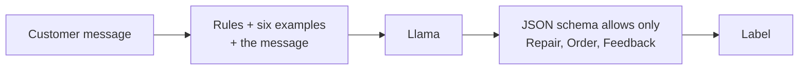
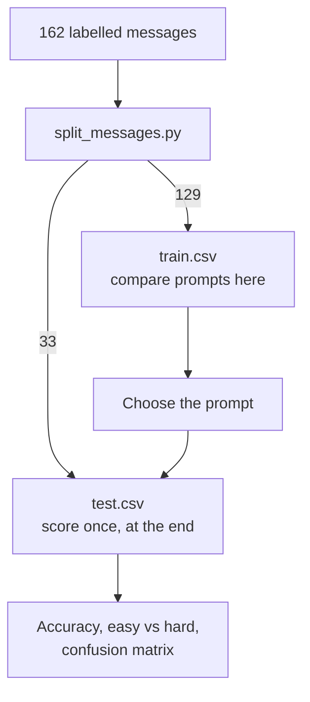

# Lesson 3: Customer-message classifier project

You sort messages sent to the Northwind Bikes shop into Repair, Order or Feedback, so each
one reaches the right person, and you measure how often the model is right.

**Why it matters:** A demo that works once proves little. A score on messages the model has never seen tells you whether to trust it, especially on the tricky cases.

Before you start: do [lesson 2](../02_prompting/). This project uses a system prompt, few-shot
examples and a JSON Schema together.

## New words

| Word | Meaning |
|------|---------|
| Classifier | A program that puts each input into one of a fixed set of categories (labels) |
| Training split | Data you are allowed to look at while you design and adjust the classifier |
| Test split | Data kept aside and scored once at the end, to see how the classifier does on new inputs |
| Accuracy | The share of answers that are correct |
| Precision | Of the messages the model put in a category, the share that really belong there |
| Recall | Of the messages that really belong in a category, the share the model found |
| Confusion matrix | A table of true category against predicted category, showing which ones get mixed up |

All course terms are in the [glossary](../../docs/glossary.md).

## Run it

```bash
python lessons/03_project/classify_messages.py               # rules plus six examples (default)
python lessons/03_project/classify_messages.py --rules-only  # rules without examples
python lessons/03_project/classify_messages.py --save        # write results_<profile>.md
```

## The ideas

The classifier has four parts:



### The prompt states the rules

The system prompt defines each category by what the customer wants now:

- Repair: work on a bike or part they already have.
- Order: buying, reserving, paying, returning, stock or delivery.
- Feedback: praise, complaints or suggestions that ask for nothing.

Some messages in [`data/`](../../data/) are marked hard. Their wording points to the wrong category: praise
followed by a repair request, a mechanic's advice that leads to a purchase, an "URGENT" note that
asks for nothing. They catch a model that goes by keywords instead of meaning.

### The schema limits the answer

The reply must be JSON with a `category` that is one of the three labels. The model cannot invent
a fourth. If the reply is still unusable, `classify` returns a fallback label. `predict` returns
`None` instead, so the evaluation can count the failure.

### Score on messages the prompt was not built on

If you adjust a prompt until it gets your examples right, a high score on those same examples
proves nothing. So the 162 messages are split in two, and each part has one job:



Report accuracy for easy and hard messages separately. A good overall number can hide a model that
fails every hard message.

### Examples are a trade-off

The default prompt includes six worked examples, written as earlier turns of the chat. Here is how
the two prompts compare on the 129 training messages, with the 3B model:

| 3B model, training split | Rules only | Rules plus six examples |
|--------------------------|-----------|--------------------------|
| All 129 messages | 92.2% | 95.3% |
| 27 hard messages | 88.9% | 81.5% |

The examples fixed many Order messages that the rules-only prompt called Feedback. But they made
the model worse on hard messages. The course did not investigate why; the confusion matrix from
`--save` is the place to start. Overall accuracy was the measure chosen in advance, so the default
keeps the examples. If hard messages matter most to you, the choice flips.

On the 33 test messages, both prompts scored 100%, and so did the 8B model. When every setup gets
everything right, the test cannot tell them apart. The training numbers above are more useful here,
as is the 8B model's score on the training split: 97.7% overall and 96.3% on hard messages. To
make the test harder, add more hard messages ([how-to](../../docs/howto/add-your-own-messages.md)).

## Code map

| File | What it shows |
|------|---------------|
| [`src/llama_course/classify.py`](../../src/llama_course/classify.py) | `SYSTEM_PROMPT`, `FEW_SHOT_EXAMPLES`, `predict`, `classify`, `metrics`, `evaluate` |
| [`src/llama_course/data.py`](../../src/llama_course/data.py) | `load_messages("train" or "test")`, which checks columns and labels |
| [`lessons/03_project/results_*.md`](./) | Saved output for each profile and prompt |

## Common mistakes

- Tuning on the test set: compare prompts on training messages. Look at the test set once.
- Reporting one number: overall accuracy can hide failures on hard messages. Split the score.
- Trusting a tiny test set: one message is 3 points here, and every setup scored 100%.
- Ignoring unusable replies: a model that fails to answer is wrong. The report counts them.

## Exercise

Reproduce the comparison above: score both prompts on the training messages with `predict` and
`score_predictions`.

<details>
<summary>Answer</summary>

```python
from llama_course.classify import FEW_SHOT_EXAMPLES, INVALID, predict, score_predictions
from llama_course.data import load_messages
from llama_course.llm import get_llm

llm, df = get_llm(), load_messages("train")
for examples in ((), FEW_SHOT_EXAMPLES):
    preds = [predict(llm, m, examples) or INVALID for m in df["message"]]
    result = score_predictions(df, preds)
    print(len(examples), result["accuracy"], result["accuracy_by_difficulty"])
```

With the 3B model at temperature 0 it prints about 0.922 overall and 0.889 on hard messages with no
examples, and 0.953 and 0.815 with six.
</details>

## Go deeper

- [scikit-learn: model evaluation](https://scikit-learn.org/stable/modules/model_evaluation.html):
  accuracy, precision, recall and the confusion matrix.
- [Pydantic JSON Schema](https://docs.pydantic.dev/latest/concepts/json_schema/): schemas from
  Python classes (used in [lesson 6](../06_tools/)).
- [Prompt Engineering Guide](https://www.promptingguide.ai/): when examples help and when they
  don't.
- [Llama 3 model card and prompt formats](https://www.llama.com/docs/model-cards-and-prompt-formats/meta-llama-3/):
  how the model expects instructions.
