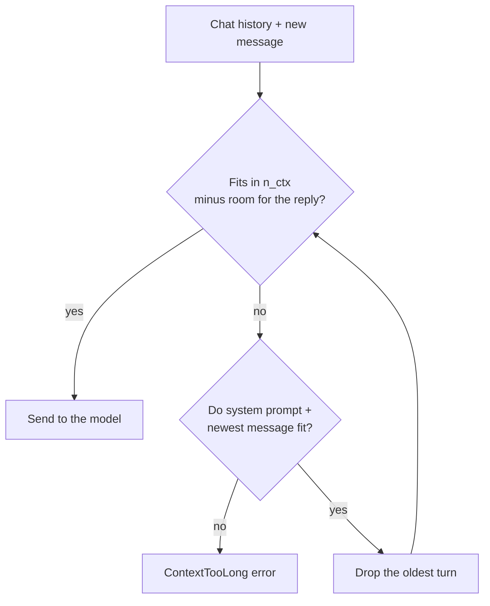

# Lesson 4: Generation

You control how the model writes: how random it is, when you see the text, and how much it can
read.

**Why it matters:** The same prompt can give different answers, and a long chat eventually stops fitting. This lesson gives you control over both.

Before you start: do [lesson 2](../02_prompting/). You should know how `Conversation` keeps a chat
history.

## New words

| Word | Meaning |
|------|---------|
| Sampling | How the model picks the next token from all the likely ones |
| Temperature | A setting for how random that pick is. 0 means no randomness |
| Seed | A number that fixes the random choices, so a run can be repeated exactly |
| Streaming | Receiving the reply token by token while it is written, instead of all at the end |
| Context window | The most tokens the model can read at once (`n_ctx`), counting both your chat and its reply |

All course terms are in the [glossary](../../docs/glossary.md).

## Run it

```bash
python lessons/04_generation/01_sampling.py
python lessons/04_generation/02_streaming.py
python lessons/04_generation/03_context_window.py
```

## The ideas

### Sampling

At each step, the model gives every possible next token a probability. For "The sky is", the token
"blue" might get a high probability and "purple" a low one. Then one token is picked. These
settings change how:

| Setting | Effect |
|---------|--------|
| `temperature` | At 0 the likeliest token is always picked, so the output repeats exactly. Higher values pick unlikely tokens more often |
| `top_p` | Pick only from the smallest group of tokens whose probabilities add up to `top_p`. This drops the unlikely ones |
| `top_k` | Pick only from the `k` likeliest tokens |
| `seed` | Fixes the random choices, so the same settings give the same text |

For sorting, extracting or anything a program reads, use temperature 0. For writing, 0.7 is a
common place to start. [Lesson 4.1](01_sampling.py) runs the same prompt at three temperatures so you can see the
difference.

### Streaming

The model writes one token at a time, so you don't have to wait for the end. With `stream=True`
you get each token as soon as it exists, and the reader can start reading right away. In a chat,
the time until the first token appears matters more than the total time. `stream_chat` gives you
the pieces one by one.

### Tokens and the context window

A token is a piece of a word. English text averages about 1.3 tokens per word. The model reads at
most `n_ctx` tokens at once, and this budget must hold your whole chat plus the reply. A prompt
that is too long fails with `ValueError: Requested tokens (1802) exceed context window of 512`.

`trim_history` keeps a long chat inside the budget. It drops the oldest turns until the chat fits.
It always keeps the system prompt and the newest message, and it never leaves the history starting
with an assistant reply:



## Code map

| File | What it shows |
|------|---------------|
| [`src/llama_course/generation.py`](../../src/llama_course/generation.py) | `stream_chat` |
| [`src/llama_course/context.py`](../../src/llama_course/context.py) | `count_tokens`, `messages_tokens`, `trim_history`, `ContextTooLong` |
| `get_llm(n_ctx=512)` | Overrides a profile setting for one call |

## Common mistakes

- Expecting the same output at temperature 0.7: pass a `seed` if you need to repeat a run.
- Forgetting the reply needs room: trim to `n_ctx` minus the reply length, not to `n_ctx`.
- Counting words instead of tokens: the token count is higher, and it differs between models.
- Per-message overhead: each chat message costs a few extra tokens for its role markers. The code
  adds 8 per message, an estimate for Llama 3.
- Raising `n_ctx` without cost: a larger window uses more memory.

## Exercise

What does `trim_history` do when the system prompt alone is longer than the budget?

<details>
<summary>Answer</summary>

It raises `ContextTooLong`: "System prompt and newest message need more than 512 tokens." Dropping
old turns cannot help, because the system prompt and the newest message are always kept. You must
shorten the prompt or raise `n_ctx`. Try it with a 600-word system prompt and `max_tokens=512`.
</details>

## Go deeper

- [The Curious Case of Neural Text Degeneration](https://arxiv.org/abs/1904.09751): the paper that
  introduced top-p (nucleus) sampling.
- [Text generation strategies](https://huggingface.co/docs/transformers/generation_strategies):
  greedy, sampling and beam search, compared.
- [Tokenizers in the Hugging Face LLM course](https://huggingface.co/learn/llm-course/chapter2/4):
  how text becomes tokens.
- [Lost in the Middle](https://arxiv.org/abs/2307.03172): models use long contexts unevenly. More
  context is not always better.
- [llama.cpp on Apple Silicon: speed numbers](https://github.com/ggml-org/llama.cpp/discussions/4167):
  tokens per second reported for many Apple chips.
