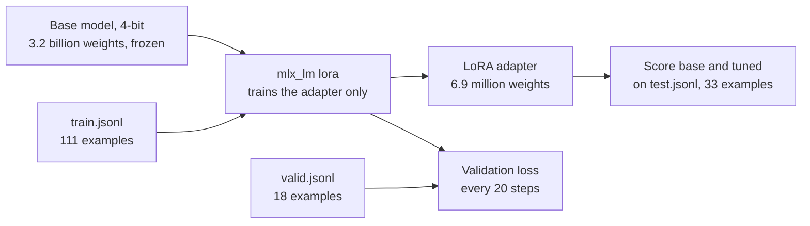

# Lesson 7: Fine-tuning

You train a small add-on for the model on your own examples, then check whether it helped. You also
learn how to score generated text.

**Why it matters:** When a prompt gets long, slow or fragile, you can teach the task by example instead. This lesson shows how, and how to check that it paid off.

Before you start: do [lesson 3](../03_project/), which gives you the score to compare against. This
lesson needs a Mac with Apple Silicon.

## New words

| Word | Meaning |
|------|---------|
| Fine-tuning | Training an existing model a little more, on your own examples |
| LoRA | Low-rank adaptation: fine-tuning that leaves the model unchanged and trains a small add-on instead |
| Adapter | That small add-on: a file of a few megabytes, loaded on top of the original model |
| Loss | A number for how wrong the model's answers are on a set of examples. Lower is better |
| Validation set | Examples the model never trains on, used to check for memorising during training |
| ROUGE | A score for generated text, based on how many words it shares with a human-written version |

All course terms are in the [glossary](../../docs/glossary.md).

## Run it

```bash
pip install -e ".[finetune]"     # Apple Silicon only
python lessons/07_finetuning/01_prepare_data.py
python lessons/07_finetuning/02_train_lora.py
python lessons/07_finetuning/03_evaluate_tuned_model.py
python lessons/07_finetuning/04_rouge_summaries.py
```

## The ideas

### Fine-tuning teaches by example

In [lesson 3](../03_project/) the prompt described the task: rules plus examples. Fine-tuning takes another route.
You show the model many pairs of a customer message and its right label, and it adjusts. After
that, the prompt can be one short line.

### LoRA trains a small add-on

Changing every weight of a 3B model needs far more memory than a laptop has. LoRA keeps the model's
weights frozen and trains a small set of extra weights instead. Here that is 0.216% of the total:
6.9 million of 3.2 billion. The result is an adapter, a file of a few megabytes, used together with
the original model.

Training on a model whose weights are stored in 4 bits is called QLoRA. It is what lets the 3B model
train in 16 GB. The course uses `mlx-lm`, a tool for Apple Silicon.



### Three data sets, three jobs

| File | Used for |
|------|----------|
| `train.jsonl` (111) | The model learns from these |
| `valid.jsonl` (18) | Checked during training to spot memorising. The model never learns from it |
| `test.jsonl` (33) | The final exam. Looked at once |

### Validation loss

During training, mlx-lm reports the loss on the training examples and on the validation examples.
Training loss usually keeps falling, because the model is learning those exact examples. Validation
loss tells you whether that learning carries over to examples it has not seen. If validation loss
starts to rise while training loss keeps falling, the model is memorising its examples. Stop
earlier. Choose the number of training steps from validation loss.

### Accuracy and the confusion matrix

Accuracy is the share of correct labels. A confusion matrix shows which labels get mixed up, for
example Order messages called Feedback. [Lesson 7.3](03_evaluate_tuned_model.py) reports easy and hard messages separately,
because a model can do well on easy messages and fail the hard ones.

### ROUGE

A summary has no single right answer, so accuracy does not work for it. [Lesson 7.4](04_rouge_summaries.py) compares each
summary with one written by a person and counts the overlap:

- ROUGE-1 counts shared words.
- ROUGE-2 counts shared pairs of words.
- ROUGE-L measures the longest shared run of words.

It is a rough measure: a good summary in different words scores low. Use it to compare two models
on the same texts, not to judge a single summary.

## Code map

| File | What it shows |
|------|---------------|
| [`src/llama_course/finetune.py`](../../src/llama_course/finetune.py) | Training examples as chats, the validation split, `parse_label` |
| [`src/llama_course/classify.py`](../../src/llama_course/classify.py) | `score_predictions`, the scoring shared with [lesson 3](../03_project/) |
| [`src/llama_course/rouge.py`](../../src/llama_course/rouge.py) | `rouge_scores` |
| [`configs/models.yaml`](../../configs/models.yaml) | `mlx_repo`: the MLX copy of each model |

## Results on the 3B model

| | Base | Tuned (60 steps) |
|---|------|-------|
| All 33 test messages | 84.8% | 97.0% |
| 27 easy messages | 81.5% | 96.3% |
| 6 hard messages | 100% | 100% |

The test set is small: one message is 3 points, so treat a difference of one or two messages as
noise. The base model here gets a short prompt with no rules. The prompt from [lesson 3](../03_project/) (rules,
examples and a schema) scores 100% on the same messages. On this synthetic data, a good prompt did
as well as fine-tuning. Fine-tuning pays off when a prompt gets long, slow or fragile, or when the
task has no short rules.

## Common mistakes

- Choosing settings from the test score: if you try several settings and keep the one with the
  best test score, the test score no longer tells you how the model does on new messages. Choose
  from validation loss, then run the test once.
- Training too long: if validation loss rises while training loss keeps falling, stop earlier.
  Check the numbers on every run; they depend on your data.
- Judging on the training data: a model that memorised its examples scores 100% on them.
- Comparing unequal setups: base and tuned must get the same prompt and the same messages.

## Exercise

In [`02_train_lora.py`](02_train_lora.py), set `ITERS = 200` and run [lessons 7.2](02_train_lora.py) and 7.3 again. What happens to
validation loss, and to the test accuracy? What should you conclude?

<details>
<summary>Answer</summary>

Validation loss was 0.282 at step 50, 0.059 at step 100, 0.001 at step 150 and 0.000 at step 200.
It never rises, so there is no sign of memorising on these 18 validation messages. With 60 steps it
was 0.487, 0.442 and 0.001 at steps 20, 40 and 60. Both runs end near 0, so the cheaper 60 steps
is the right choice.

Test accuracy at 200 steps was 100%, against 97.0% at 60 steps. That is one message out of 33, and
it is not a reason to pick 200: choosing steps by test score would use up the test set. Also, 18
validation messages are too few and too easy to show memorising. With your own data, add more
validation examples before you trust a flat validation curve.
</details>

## Go deeper

- [LoRA: Low-Rank Adaptation of Large Language Models](https://arxiv.org/abs/2106.09685): the
  original paper.
- [QLoRA](https://arxiv.org/abs/2305.14314): fine-tuning on a 4-bit model.
- [mlx-lm LoRA guide](https://github.com/ml-explore/mlx-lm/blob/main/mlx_lm/LORA.md): every option of
  `mlx_lm lora`.
- [MLX documentation](https://ml-explore.github.io/mlx/build/html/index.html): Apple's array
  framework under `mlx-lm`.
- [Hugging Face PEFT](https://huggingface.co/docs/peft/index): the same idea on PyTorch, the usual
  route on Linux and NVIDIA GPUs.
- [ROUGE: A Package for Automatic Evaluation of Summaries](https://aclanthology.org/W04-1013/): the
  paper that defines the scores.
- [scikit-learn: model evaluation](https://scikit-learn.org/stable/modules/model_evaluation.html):
  precision, recall and confusion matrices explained.
