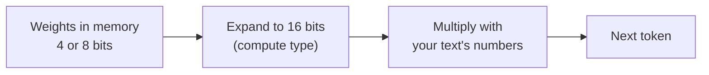

# Lesson 8: Quantization

You run the same model stored at two sizes, 8-bit and 4-bit, and measure what changes: file size,
memory, speed and accuracy.

**Why it matters:** Quantization decides which models fit on your machine and how fast they answer. Knowing what it costs lets you pick a model file on evidence instead of guessing.

Before you start: do [lesson 3](../03_project/), which gives you the challenge set used here. Then
download the 8-bit file: `python scripts/download_model.py --profile laptop-16gb-q8` (3.4 GB).

## New words

| Word | Meaning |
|------|---------|
| Bits per weight | How much storage each of the model's numbers uses. Fewer bits = smaller file, less precision |
| 16-bit | The precision models are usually trained and released in |
| bfloat16 | A 16-bit number format with a wide range and less precision, common for model maths |
| 8-bit, 4-bit | Weights stored in 8 or about 4 bits instead of 16 |
| NF4 | "NormalFloat 4": a 4-bit format designed for weights that follow a bell curve |
| Compute type | The format the maths is done in. Weights can be stored in 4 bits but expanded to 16 bits for each calculation |

All course terms are in the [glossary](../../docs/glossary.md).

## Run it

```bash
python lessons/08_quantization/01_compare_quantization.py
```

## The ideas

### What quantization does

A 3B model has about 3 billion weights. At 16 bits each that is about 6 GB. Quantization stores
each weight with fewer bits, rounding it to the nearest value the smaller format can hold:

| Format | Bits per weight | 3B model file |
|--------|-----------------|---------------|
| 16-bit (original) | 16 | about 6 GB |
| Q8_0 | 8 | 3.4 GB |
| Q4_K_M | about 4.5 | 2.0 GB |

The rounding loses a little precision. How much that matters depends on the task, so you measure it.

### Stored small, computed in 16 bits

The weights stay small in memory. When the model needs them for a calculation, they are expanded
back to 16 bits, used, and thrown away:



This is why smaller files are usually faster. Producing each token means reading every weight from
memory, and reading 2 GB takes less time than reading 3.4 GB.

### Results on this machine

Measured on a MacBook Pro (Apple Silicon, 16 GB), one run each:

| Profile | File | Size | Load | Speed | Peak memory | Challenge accuracy (60) |
|---------|------|------|------|-------|-------------|-------------------------|
| `laptop-16gb` | Llama-3.2-3B-Instruct-Q4_K_M.gguf | 2.0 GB | 1.3 s | 54.5 tokens/s | 2,712 MB | 98.3% |
| `laptop-16gb-q8` | Llama-3.2-3B-Instruct-Q8_0.gguf | 3.4 GB | 1.6 s | 43.6 tokens/s | 3,961 MB | 95.0% |

The 4-bit file is 41% smaller and 25% faster. It also scored higher on the challenge set, but that
is a two-message difference on 60 messages: noise, not proof that 4 bits is more accurate. What the
numbers do show is that for this task, going from 8 to 4 bits cost nothing measurable.

### Two ways to load a quantized model

The course uses GGUF files, which are quantized once and saved to disk. llama.cpp reads them
directly.

In the PyTorch world, the `bitsandbytes` library quantizes a model while it loads. This is the
setup you will see in many tutorials:

```python
# Reference only: this course does not install or run the PyTorch stack.
import torch
from transformers import AutoModelForCausalLM, BitsAndBytesConfig

eight_bit = BitsAndBytesConfig(load_in_8bit=True)

four_bit = BitsAndBytesConfig(
    load_in_4bit=True,
    bnb_4bit_quant_type="nf4",              # NF4: 4-bit format for bell-curve weights
    bnb_4bit_compute_dtype=torch.bfloat16,  # expand to bfloat16 for each calculation
)

model = AutoModelForCausalLM.from_pretrained("some/model", quantization_config=four_bit)
```

The ideas are the same: fewer bits in storage, 16-bit maths. `bitsandbytes` has a build for Apple
Silicon Macs, but this course has not tested it.

## Code map

| File | What it shows |
|------|---------------|
| [`configs/models.yaml`](../../configs/models.yaml) | The `laptop-16gb` (4-bit) and `laptop-16gb-q8` (8-bit) profiles |
| [`src/llama_course/benchmark.py`](../../src/llama_course/benchmark.py) | The speed measurement used here |
| [`results_laptop-16gb.md`](results_laptop-16gb.md) | The saved table |

## Common mistakes

- Comparing on one prompt: speed and accuracy vary between runs. Use the same prompts and messages
  for every file.
- Reading a small accuracy gap as a result: two messages out of 60 is noise.
- Measuring memory for two models in one process: the peak includes both. The script runs each
  file in its own process for this reason.
- Assuming more bits is always worth it: check your own task first. Here 8 bits meant a 70%
  bigger file and 46% more memory, for no measurable gain.

## Exercise

On a 16 GB Mac you can fit the 8B model at 4 bits (`laptop-8b`) or the 3B model at 8 bits
(`laptop-16gb-q8`). Which would you pick for the shop's message classifier? Use the numbers in this
lesson and in [Change models](../../docs/howto/switch-models.md).

<details>
<summary>Answer</summary>

| | 3B at 8 bits | 8B at 4 bits |
|---|--------------|--------------|
| File | 3.4 GB | 4.9 GB |
| Speed | 43.6 tokens/s | 23.2 tokens/s |
| Challenge set | 95.0% | 98.3% |
| Hard training messages | not measured | 96.3% (3B at 4 bits: 81.5%) |

The 8B model at 4 bits. Here the extra weights helped more than the extra precision: it scored
higher on both sets that could tell the models apart. It costs speed, which matters little for
sorting messages. If you need fast chat replies, the 3B model at 4 bits is the better trade.
</details>

## Go deeper

- [QLoRA](https://arxiv.org/abs/2305.14314): the paper that introduced NF4 and 4-bit fine-tuning.
- [llama.cpp quantization](https://github.com/ggml-org/llama.cpp/blob/master/tools/quantize/README.md):
  the GGUF formats such as Q4_K_M and Q8_0.
- [A Gentle Introduction to 8-bit Matrix Multiplication](https://huggingface.co/blog/hf-bitsandbytes-integration):
  how 8-bit loading works.
- [4-bit quantization with bitsandbytes](https://huggingface.co/blog/4bit-transformers-bitsandbytes):
  NF4 and the compute type, explained with code.
- [bitsandbytes in Transformers](https://huggingface.co/docs/transformers/main/en/quantization/bitsandbytes):
  every loading option.
- [bfloat16](https://en.wikipedia.org/wiki/Bfloat16_floating-point_format): the 16-bit format.
